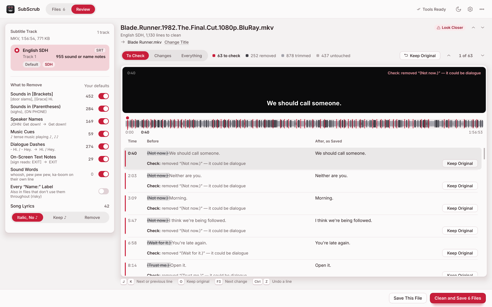
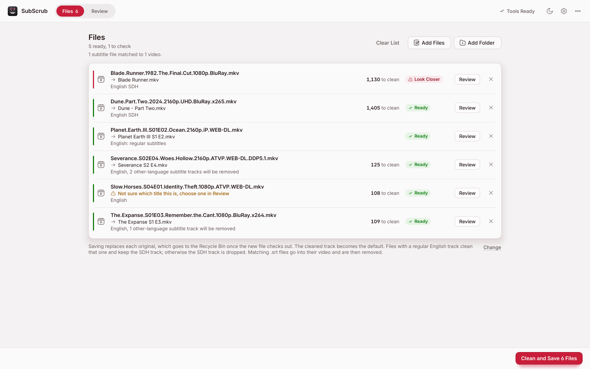
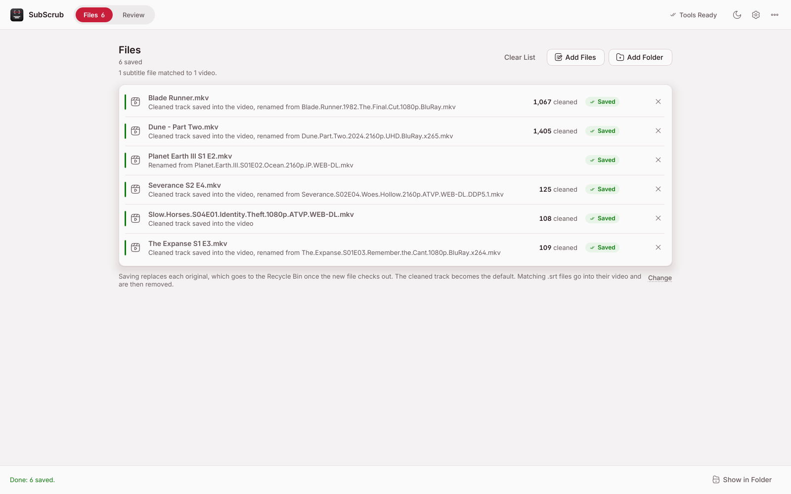
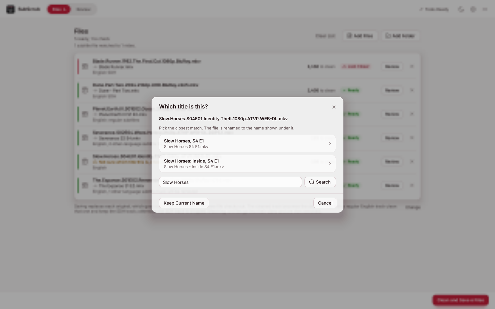
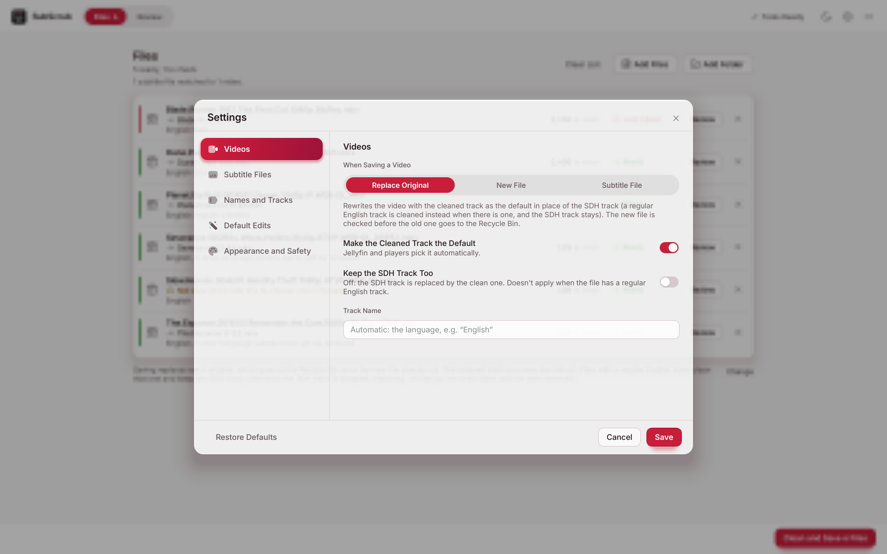

# SubScrub

**SubScrub strips the sound descriptions, speaker names and music cues out of SDH subtitles and puts the cleaned
track back into your video as the default, without re-encoding.**

**[Download the latest version](https://github.com/4RK0S4H4/SubScrub/releases/latest)** (`SubScrub-Setup.exe`, Windows 10 and 11)

<picture>
  <source media="(prefers-color-scheme: dark)" srcset="docs/screenshots/review-dark.png">
  
</picture>

`[gunshot in background]`, `(sighs)`, `JOHN:`, `♪ tense music ♪` and dialogue dashes go; the words people say stay.
Audio and video are copied bit for bit, so a save takes about as long as copying the file. It works on MKV and other
videos, and on standalone `.srt`, `.ass` and `.vtt` files. It can also rename videos from TMDB
(`The Walking Dead S7 E2.mkv`) and remove subtitle tracks in other languages.

Tuned on a real library of 299 videos (72 English SDH tracks from WEB-DL, Blu-ray and OCR'd releases): 70 of the 72
tracks come out with no judgement calls at all, and the other two (both OCR'd from disc images) have a few lines the
app asks about.

## Install

1. Download **`SubScrub-Setup.exe`** from the [latest release](https://github.com/4RK0S4H4/SubScrub/releases/latest)
   and run it. It installs just for you (no administrator prompt), adds Start-menu and desktop shortcuts, and
   keeps your settings when you update later.
2. SubScrub isn't code-signed, so the first time Windows may say **"Windows protected your PC"**. Click **More info**,
   then **Run anyway**. You'll see this once per version.
3. SubScrub needs **FFmpeg** (required) and **MKVToolNix** (recommended for MKV files). If they're missing, the top
   bar says so and its **Tools** button installs them for you.

**Updates:** once a day SubScrub checks for a newer version and, if there is one, shows a quiet banner with
**Update** and **Later**. Update downloads the installer, checks it, installs it and restarts SubScrub. Nothing is
downloaded until you click, and it never runs during a save. You can also check from ⋯ → **Check for Updates…** or
the **About** screen, and switch the daily check off in Settings.

## Using it

1. **Drop files** on the window: videos, a whole season folder, or `.srt` / `.ass` / `.vtt` files.
2. Each file gets a status once it's read:
   - **Ready**: confident, nothing to look at.
   - **3 to Check**: a few judgement calls, for example words in parentheses that might be dialogue.
   - **Look Closer**: lots of judgement calls, usually a track OCR'd from disc images.
   - **No SDH** / **Already Clean**: nothing to strip. The file is skipped (open it to clean it anyway).
   - **Can't Edit**: picture-based subtitles (Blu-ray PGS, DVD VobSub).
   - **In Use**: another program has the file open (see below).
3. **Clean and Save.** If some files have judgement calls, you choose on the spot: review them now, save with
   SubScrub's best guess, save but leave those lines alone, or save only the other files.

<picture>
  <source media="(prefers-color-scheme: dark)" srcset="docs/screenshots/files-dark.png">
  
</picture>

Saved files show what happened to them:

<picture>
  <source media="(prefers-color-scheme: dark)" srcset="docs/screenshots/saved-dark.png">
  
</picture>

### Which subtitle track gets cleaned

- If the file already has a **regular English track**, that one is cleaned (to catch stray notes), made the default
  and named "English". The **SDH track stays**, just no longer the default. There is no duplicate English track.
- If the only English track is **SDH** (flagged, named, or recognised by its content), that one is cleaned and the
  SDH original is dropped.
- Commentary, forced and signs/songs tracks are never picked. A track you pick by hand in Review always wins.

### Videos with subtitle files next to them

Drop the whole folder. A subtitle file named after a video (`Show - S01E01.eng.srt` next to `Show - S01E01.mkv`,
also `.en.sdh.srt`, `.srt`, `.forced.srt`) becomes part of that video. SubScrub cleans the right track, puts it
**into the video** as the default, and moves the `.srt` (and other same-language subtitle files next to that video)
to the Recycle Bin, so **each video ends up as one file**. Forced-subtitle files are never removed, and subtitle files
with no matching video are left alone. Turn this off in Settings → **Subtitle Files**.

### Review

Click a file (or **Review**) to see it up close.

<picture>
  <source media="(prefers-color-scheme: dark)" srcset="docs/screenshots/review-dark.png">
  
</picture>

- **Subtitle track:** which track is cleaned, and how many sound or name notes it has.
- **What to Remove** (left): every kind of edit with how many lines it touches. Switch one off to see the result
  without it; *Use these for all files* makes your choice the default.
- **Preview:** a dark "screen" shows the selected line the way it will look on the TV. The timeline marks removed
  lines (light), trimmed lines (grey) and lines to check (red). The list shows Before and After. **To Check** lists
  only the judgement calls, each with its reason.
- **Keep Original** puts any line back exactly as it was (double-click works too).

| Key | Does |
|---|---|
| `J` / `K` | Next / previous line |
| `O` | Keep the original of the selected line (press again to use the cleaned text) |
| `F3` / `Shift`+`F3` | Next / previous change |
| `Ctrl`+`Z` | Undo a line |
| `Ctrl`+`S` | Save |
| `Esc` | Back to Files |

### When it isn't sure

If a line could be dialogue, SubScrub marks it **to check** and asks at save time; it never learns from your answers.
When a title isn't a clear match for renaming, it shows the closest matches to pick from:

<picture>
  <source media="(prefers-color-scheme: dark)" srcset="docs/screenshots/not-sure-dark.png">
  
</picture>

## What gets cleaned

| Edit | Example | Default |
|---|---|---|
| Sounds in [brackets] (incl. `[Grace]` speaker IDs) | `[door creaks] Hello?` → `Hello?` | on |
| Sounds in (parentheses) | `(sighs) Fine.` → `Fine.` | on |
| Speaker names | `JOHN: Get down!`, `NAOMI:Take it easy.`, `Nice.HOLDEN: Shut up.` | on |
| Music cues | `♪ tense music playing ♪`, `♪♪`, `(MUSIC FADES)` | on |
| Song lyrics | `♪ Walking down the street ♪` → *Walking down the street* | italic, no ♪ |
| Dialogue dashes, every kind | `- Hi.` / `– Hey.` / `— Yo.` / `-- Wait.` → `Hi.` / `Hey.` / `Yo.` / `Wait.` | on |
| On-screen text notes | `[sign reads: EXIT]` → `EXIT` | on |
| OCR repairs (disc-converted tracks only) | `j" mad world` → *mad world*, `How can [help you?` → `How can I help you?` | on |
| Every `Name:` label | `Man on TV: Hello` → `Hello`, even in files that don't use them throughout | off |

Dashes inside a sentence stay (`Wait — what?`, `I'm--I'm sorry.`, `Wait-`). Parentheses in the middle of a sentence that
sound like speech (`Mom (she's in the car) is fine.`, `We need 2 (two) guns.`) are removed but **marked to check**, so
you decide.

Things it handles that trip up simpler tools (all seen in real files):

- Speaker names with no space, glued to the previous sentence, mid-line (`something nice? -IAN: No.`), with quotes
  (`WILLIAM "BILLY" MACON:`), with qualifiers (`MAN [OVER RADIO]:`), `McDOWELL:`, `COMPUTER;`.
- Files that write names like `Harrington:` throughout are detected and cleaned; a normal file's
  `Warning: the following images are graphic.` is left alone.
- Lyrics vs. music descriptions: `♪ ...how this ends ♪` and `♪ When the music starts ♪` are lyrics, not cues.
- Nested and multi-line notes: `(MUSIC FADING UP, "BRANDY (YOU'RE A FINE GIRL)" PLAYING)`.
- On-screen text cards (`PASSIVE SCAN / MAXIMUM RANGE`, title cards) are kept.
- Italics, `{\an8}` positioning and ASS styling (including `\n` soft line breaks) are preserved; lines nothing touches
  stay byte for byte identical. Original line breaks are kept: nothing is reflowed.

## Renaming and tidying tracks (optional)

- **Rename videos from TMDB.** `Batman V Super Dawn of Justice 2160 HDR DV DDP.mkv` becomes
  `Batman v Superman - Dawn of Justice.mkv`; episodes become `The Walking Dead S7 E2.mkv` (two-part files read
  `S2 E1-E2`). Names are Windows-safe, no folders are created, and the year is off unless you turn it on. Matching
  `.srt` files are renamed with the video. ⋯ → **Undo Last Renames…** puts the previous names back.
- It reads awkward file names too: `Movie.Name.(2020).1080p`, `Mission.Impossible.-.Fallout.2018`, `Show_S01E02`,
  `Movie Name [2020]`, `Show Season 1 Episode 2`, `Show.S2024E01`.
- **Tidy the tracks.** The cleaned track is called just "English". Subtitle tracks in other languages are removed;
  forced tracks and tracks with no language stay.
- Needs a free TMDB API key (themoviedb.org → Settings → API), pasted in Settings → **Names and Tracks**. Renaming
  and the tidy-up apply when originals are replaced.

## Safe saving

- **Replace Original** (the default) writes a new file next to the old one, **checks it**, and only then moves the
  original to the Recycle Bin. The check covers the video and audio tracks, the length, the subtitle tracks, the
  **attached fonts, the chapters, and that the cleaned track really holds the cleaned lines**. If anything is off,
  nothing is replaced and you're told why.
- A track where cleaning would remove **every line**, or an empty subtitle file, is left alone with a message.
- Files another program has open can't be rewritten (see below). A path too long for Windows is refused up front.
- If a save was interrupted (a crash, a power cut), SubScrub offers to move the unfinished
  `Name.subscrub-tmp.mkv` to the Recycle Bin when you next add that folder. It never deletes one by itself, and if
  the original is missing it offers to rename the leftover back instead. Closing the window mid-save waits until the
  tool has really stopped.

## Settings (⚙)

<picture>
  <source media="(prefers-color-scheme: dark)" srcset="docs/screenshots/settings-dark.png">
  
</picture>

- **Videos:** *Replace Original* (default), *New File* (`Movie.dialogue.mkv`) or *Subtitle File* (`Movie.en.srt`,
  nothing remuxed). *Make the Cleaned Track the Default* (on), *Keep the SDH Track Too* (off; it only matters when an
  SDH track is the one cleaned), track name.
- **Subtitle Files:** *One File per Video* (on). For subtitle files with no matching video: embed, replace or new file.
- **Names and Tracks:** TMDB renaming, the year, other-language tracks, your TMDB key.
- **Default Edits:** every kind of edit, and the lyrics style.
- **Appearance and Safety:** theme (*Automatic* follows Windows live), asking before rewriting files, the daily update
  check, and the optional Windows 11 Mica backdrop.

**Jellyfin:** after replacing files, run *Refresh metadata* on them so Jellyfin sees the new track.

**Files that are in use (seeding, playing, Jellyfin scanning):** SubScrub checks before it changes anything. Files
open elsewhere show **In Use** with the program's name (for example *open in qBittorrent*), and pressing save first
lists them so you can pause those torrents and click **Check Again** (or skip them). If a file gets opened mid-save
anyway, nothing is changed and no extra copy is left behind. Once a file is rewritten its torrent can't keep seeding
it: remove the torrent afterwards (keep the files), or use *New File* to keep the original for seeding.

## Limits

- **Windows only**, and **picture-based subtitles can't be edited** (Blu-ray PGS, DVD VobSub): they would need OCR
  first, which SubScrub doesn't do. Such files show **Can't Edit**.
- Tracks OCR'd by release groups contain garbled text the app can't know about (`E d ith.`); it fixes the common
  patterns and flags the rest.
- SubScrub only touches files you pick. There is no whole-library mode.

## What's new

### Next version (not released yet)

- **A real installer and updates.** `SubScrub-Setup.exe` installs without administrator rights, with shortcuts and an
  uninstaller. SubScrub checks for new versions once a day and updates itself with one click; also in ⋯ and About.
- **Review shortcuts:** `J` / `K` move between lines and `O` keeps the original, shown as keycaps under the list.
- **The regular English track comes first.** If a file has one, that is the track that gets cleaned and made the
  default, and the SDH track stays. Only-SDH files behave as before.
- **Safer saving.** The new file is also checked for attached fonts, chapters and the cleaned line count before the
  original goes to the Recycle Bin. Unfinished temporary files are offered for removal. Tracks or subtitle files that
  would end up empty are left alone, and over-long Windows paths are refused up front.
- **Cleaning fixes.** Dialogue dashes of every kind (`– — ‐ ‑ −`, `--`) and ASS soft line breaks; speech-like words in
  mid-sentence parentheses are marked to check instead of vanishing silently.
- **Better file-name reading** for TMDB (see above).
- **Tested properly.** The whole suite, including saves on generated videos and awkward files, runs on Windows and
  Linux for every change.

### 2.8

**A rebuilt interface (S4 Glass), and a faster Review screen.** Nothing about how files are cleaned, renamed or saved
changed.

- A top bar with **Files** and **Review** tabs. Settings, the light/dark switch and the ⋯ menu stay in the same place
  on every screen, and the main button sits in the footer.
- Glass cards over a softly tinted backdrop: the greys carry a faint hint of the crimson accent. Crimson only marks the
  main button, switches, the selected item and lines to check.
- Each file shows its state as a coloured bar on its left edge plus one badge.
- Settings, About, the activity log and every question open inside the window over a blurred background.
- Review responds faster: "Keep Original" on a line is about 4× quicker, stepping through lines about 4×, switching
  filters and scrolling about 2×. On a small window the toolbar shows "Keep Original" as an icon.

Older versions are in [docs/HISTORY.md](docs/HISTORY.md).

## For developers

```
python -m pip install -r requirements.txt pyinstaller pillow
python run.py                          # run from source
python -m tests.test_cleaner           # rule tests and the cleaner corpus (tests/fixtures/corpus.tsv)
python -m tests.test_pipeline          # end-to-end saves on generated videos (needs ffmpeg + mkvmerge)
python -m tests.test_edge              # awkward files through the real save path
python -m tests.test_ui                # contrast, main flows, every dialog (QT_QPA_PLATFORM=offscreen)
build.bat                              # local build -> dist\SubScrub.exe
```

More in [CLAUDE.md](CLAUDE.md). Every change runs the tests on Windows (with FFmpeg and MKVToolNix) and Linux, builds
`SubScrub.exe` and `SubScrub-Setup.exe` (Inno Setup, `installer/SubScrub.iss`) and checks that the installer installs,
starts and uninstalls. The screenshots above come from a generated sample library
(`python -m tests.make_samples --library`), never from real files. To release: bump `subscrub/__init__.py`, update
this file, merge, then run the `build` workflow on `main` with the version typed in.

- `subscrub/cleaner.py`: the rules, per-line risk grading, file-level detection (OCR, `Name:` style) and the
  cross-check against the regular track
- `subscrub/batch.py`: picking the track to clean (regular first, else SDH), sidecar pairing, rename helpers
- `subscrub/subformats.py`: SRT / ASS / WebVTT reading and writing
- `subscrub/media.py`: FFmpeg/MKVToolNix discovery, extraction, remuxing, the safe swap and its checks
- `subscrub/naming.py`: TMDB lookup, scoring, Windows-safe names, rename history
- `subscrub/updates.py`: the update check and the installer download
- `subscrub/ui/`: the PySide6 interface (`main_window.py` Files/Review, `preview.py` the timeline and list)

**Testing against your own library:** `tools\extract-subs.ps1` dumps every English text subtitle track from a drive
(videos are only read):

```
powershell -ExecutionPolicy Bypass -File tools\extract-subs.ps1 -Root "F:\" -Out "F:\subdump" -MaxPerFolder 3 -AllFrom Movies
```

Then `python tools\corpus_check.py F:\subdump` shows what SubScrub would do to each track: its confidence, every line it
would ask about, and anything that still looks like SDH after cleaning.

Credits: Inter (SIL OFL 1.1, see `assets/fonts/OFL-Inter.txt`); Solar icons by 480 Design (CC BY 4.0).
